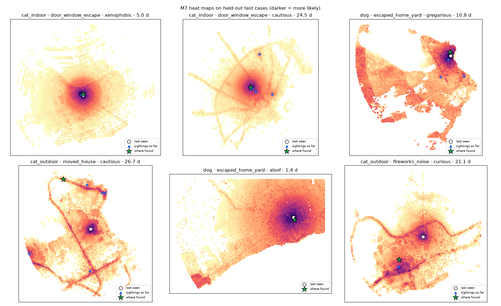

# M7 model report

Trained 2026-10-18 17:37 UTC · best iteration 348 · 48 features

Evaluated on **held-out test areas** (3 km spatial blocks the model never saw), scoring every cell of a full lattice around each case (50 m cells for cats within 4 km, 100 m cells for dogs within 12 km).

- **area_model**: km² you would search, best cells first, before reaching the pet
- **area_circle**: the same with the usual widening-circle search from the last-seen point
- **in_X%_zone**: how often the pet is inside the zone the model says holds X% of the probability (a well-calibrated model gets ~X%)
- Pets that came home by themselves are excluded (home is not a search area); see `self_return_rate` in m7_meta.json
- **full** = every input known; **minimal** = what today's app form collects (no temperament / lifestyle / collar / circumstance / home, no sighting pins)

|                            |   cases |   median_area_model_km2 |   median_area_circle_km2 | found_in_0.25km2_model   | found_in_0.25km2_circle   | found_in_1km2_model   | found_in_1km2_circle   | top_5pct_cells   | in_50pct_zone   | in_80pct_zone   | in_95pct_zone   |
|:---------------------------|--------:|------------------------:|-------------------------:|:-------------------------|:--------------------------|:----------------------|:-----------------------|:-----------------|:----------------|:----------------|:----------------|
| ('full', 'cat_indoor')     |     120 |                    0    |                     0.01 | 95%                      | 94%                       | 99%                   | 99%                    | 99%              | 57%             | 82%             | 99%             |
| ('full', 'cat_outdoor')    |     120 |                    0.54 |                     0.79 | 39%                      | 39%                       | 55%                   | 53%                    | 69%              | 51%             | 78%             | 92%             |
| ('full', 'dog')            |     120 |                    0.43 |                     0.7  | 42%                      | 33%                       | 67%                   | 57%                    | 88%              | 54%             | 81%             | 94%             |
| ('minimal', 'cat_indoor')  |     120 |                    0.01 |                     0.01 | 94%                      | 94%                       | 99%                   | 99%                    | 99%              | 69%             | 97%             | 99%             |
| ('minimal', 'cat_outdoor') |     120 |                    0.64 |                     0.79 | 38%                      | 39%                       | 56%                   | 53%                    | 68%              | 12%             | 45%             | 87%             |
| ('minimal', 'dog')         |     120 |                    0.65 |                     0.7  | 36%                      | 33%                       | 60%                   | 57%                    | 88%              | 53%             | 86%             | 96%             |

## Most important features (share of gain)

|                      |   gain |
|:---------------------|-------:|
| log_dist_home        |  0.1   |
| dist_per_sqrt_t      |  0.095 |
| group                |  0.09  |
| toward_home_cos      |  0.077 |
| dist_m               |  0.071 |
| last_seen_accuracy_m |  0.055 |
| water                |  0.043 |
| cover                |  0.038 |
| t_hours              |  0.034 |
| log_dist             |  0.03  |
| corridor             |  0.029 |
| latest_sighting_m    |  0.026 |
| nearest_sighting_m   |  0.025 |
| species              |  0.022 |
| home_distance_m      |  0.022 |
| dist_major_m         |  0.02  |
| circumstance         |  0.016 |
| log_t                |  0.016 |
| cover_200m           |  0.015 |
| breed_group          |  0.014 |

