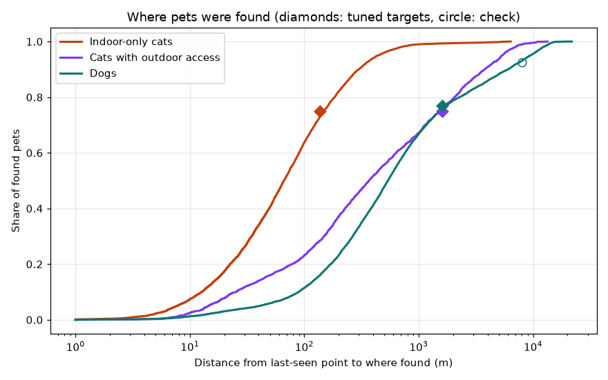
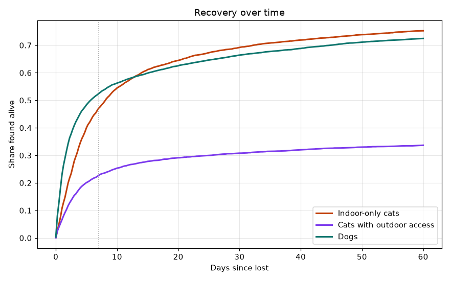
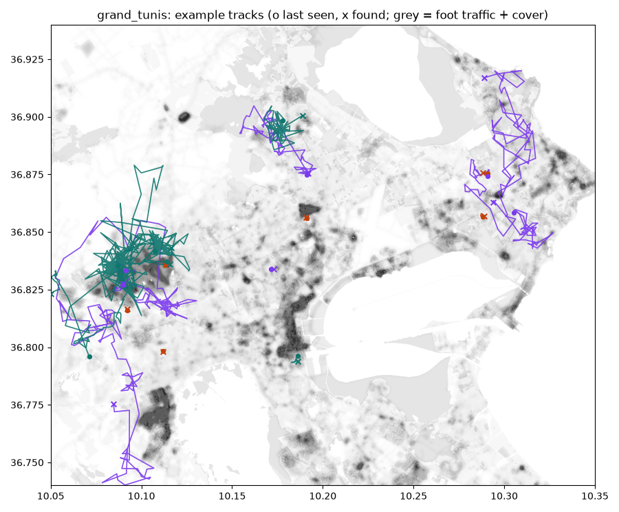
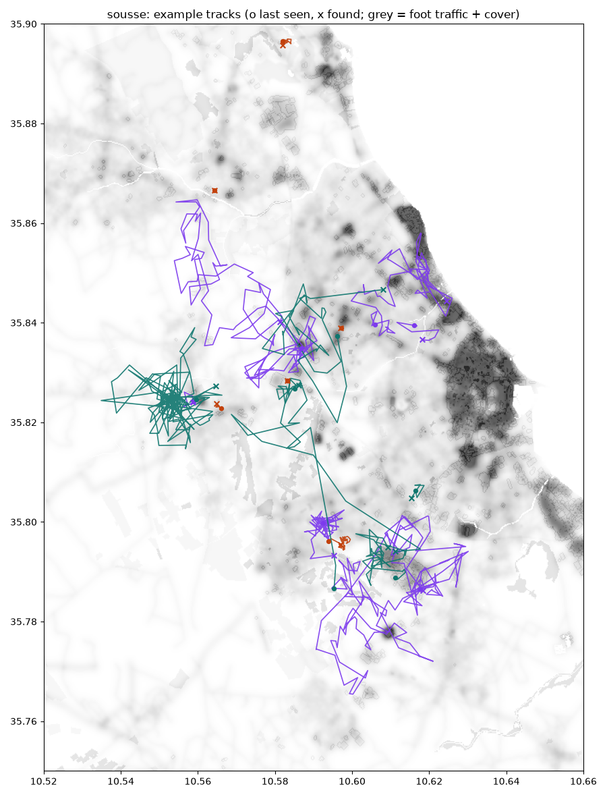
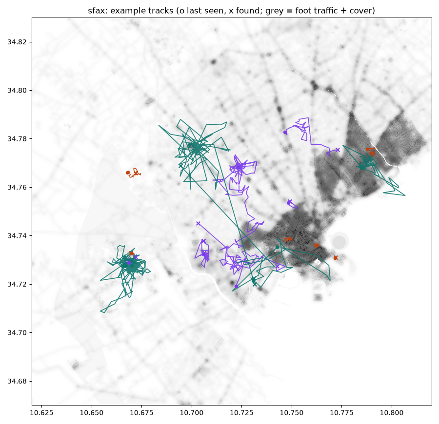
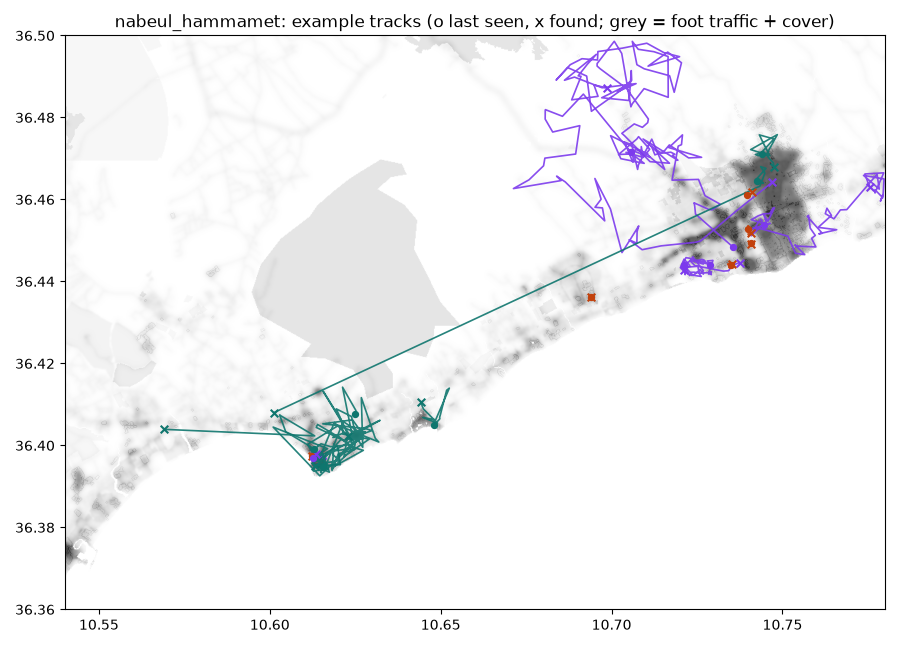

# M7 dataset validation

24,000 cases, 2,939,399 track points, 111,523 sightings (24% false).

## Published targets

| Metric | Target | Achieved | Status | Source | Tuned for |
|---|---|---|---|---|---|
| Indoor cats: 75th pct distance (m) | 137 m | 148 m | ok | Huang 2018 | yes |
| Outdoor cats: 75th pct distance (m) | 1,609 m | 1,512 m | ok | Huang 2018 | yes |
| Cats found alive within 7 days | 34% | 36% | ok | Huang 2018 | yes |
| Dogs: share found within 1,609 m | 77% | 76% | ok | Lord 2007 | yes |
| Dogs recovered alive | 71% | 72% | ok | Lord 2007 | yes |
| All cats: share found within 500 m | 75% | 84% | close | Huang 2018 | no (check) |
| Dogs: share found beyond 8 km | 8% | 7% | ok | Lord 2007 | yes |
| Dogs: median days to recovery | 2.0 d | 2.2 d | ok | Lord 2007 | yes |
| Cats found (any outcome, 60 days) | 61% | 62% | ok | Huang 2018 (1 year) | no (check) |

Status: ok = within 15% (relative); shares within 5 points and at most a quarter of the target. close = within twice that.

Calibrated parameters: `{'cat_indoor': {'speed_mult': 0.204, 'detect_mult': 0.797, 'search_floor': 0.15, 'relocate_mult': 1.0}, 'cat_outdoor': {'speed_mult': 1.428, 'detect_mult': 0.797, 'search_floor': 0.15, 'relocate_mult': 1.0}, 'dog': {'speed_mult': 0.688, 'detect_mult': 1.093, 'search_floor': 0.053, 'relocate_mult': 8.545}}`

## Outcomes by group

| group       |   found_by_owner |   found_by_public |   found_dead |   not_found |   picked_up_vet_municipality |   returned_home |   taken_in_by_stranger |
|:------------|-----------------:|------------------:|-------------:|------------:|-----------------------------:|----------------:|-----------------------:|
| cat_indoor  |            0.646 |             0.058 |        0.028 |       0.219 |                        0.004 |           0.039 |                  0.006 |
| cat_outdoor |            0.204 |             0.07  |        0.09  |       0.573 |                        0.005 |           0.045 |                  0.013 |
| dog         |            0.358 |             0.162 |        0.074 |       0.202 |                        0.023 |           0.049 |                  0.133 |

## Where found (place type)

| found_place_type         |   cat_indoor |   cat_outdoor |   dog |
|:-------------------------|-------------:|--------------:|------:|
| cemetery                 |        0.005 |         0.005 | 0.005 |
| farmland_olive_grove     |        0.018 |         0.021 | 0.022 |
| home                     |        0.05  |         0.105 | 0.061 |
| inside_building_block    |        0.153 |         0.122 | 0.087 |
| major_road               |        0.032 |         0.12  | 0.061 |
| market_restaurants       |        0.023 |         0.032 | 0.028 |
| near_buildings_courtyard |        0.085 |         0.045 | 0.05  |
| open_ground              |        0.349 |         0.29  | 0.324 |
| park_garden              |        0.053 |         0.054 | 0.05  |
| residential_street       |        0.155 |         0.141 | 0.263 |
| scrub_woodland           |        0.016 |         0.023 | 0.011 |
| vacant_lot_construction  |        0.059 |         0.042 | 0.038 |

## Median distance by temperament (m)

| temperament   |   cat |   dog |
|:--------------|------:|------:|
| aloof         |   nan |   555 |
| cautious      |    92 |   nan |
| curious       |    97 |   nan |
| gregarious    |   nan |   564 |
| xenophobic    |   102 |   461 |

## Median distance by circumstance (m)

| circumstance       |   cat |   dog |
|:-------------------|------:|------:|
| balcony_fall       |    43 |   nan |
| car_accident       |   nan |  2135 |
| did_not_return     |   253 |   nan |
| door_window_escape |    50 |   nan |
| escaped_home_yard  |   nan |   360 |
| fireworks_noise    |   158 |   479 |
| followed_dogs      |   nan |   334 |
| moved_house        |   148 |  1577 |
| slipped_leash_walk |   nan |   681 |
| transport_escape   |   209 |  1522 |

## Split sizes (spatial 3 km blocks)

| split   |   grand_tunis |   nabeul_hammamet |   sfax |   sousse |
|:--------|--------------:|------------------:|-------:|---------:|
| test    |           855 |              1875 |   1510 |        4 |
| train   |          6990 |              1977 |   2606 |     4566 |
| val     |          1155 |              1148 |    884 |      430 |

## Example tracks

